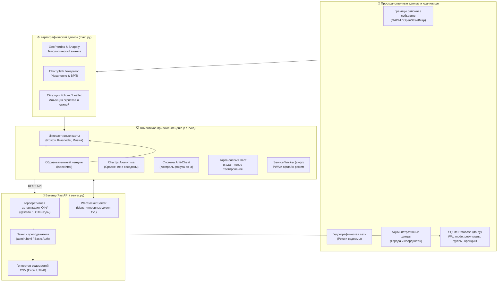

# 🌍 GeoAtlas Edu — Интерактивный геоинформационный и экономический комплекс

<p align="center">
  
  
  
  
  
  
  
  
</p>

---

> [!NOTE]
> **Академический контекст проекта**  
> Проект разработан в рамках выпускной квалификационной работы по направлению подготовки:  
> **44.03.05 «Педагогическое образование с двумя профилями подготовки: география и экономика»**.  
> **Автор:** Литвинов Е. К.  
> **Учебное заведение:** Институт наук о Земле Южного федерального университета (ЮФУ), г. Ростов-на-Дону.

---

## 📌 О проекте

**GeoAtlas Edu** — это учебно-методический аппаратно-программный комплекс, объединяющий возможности настольных географических информационных систем (ГИС), веб-картографии и современной образовательной платформы.

Комплекс решает фундаментальную задачу межпредметной интеграции **географии** и **экономики**: студенты и школьники изучают не просто административно-территориальное деление и гидрографию, но и пространственные социально-экономические закономерности (валовой региональный продукт — ВРП, численность и плотность населения, межтерриториальные связи и экономическое лидерство).

Платформа включает в себя:
* **Мультимасштабный геоатлас** (Ростовская область, Краснодарский край, Российская Федерация — 85+ субъектов);
* **Интерактивные аналитические профили территорий** со сравнительными диаграммами Chart.js;
* **Обучающий режим (Study Mode)** для самостоятельного исследования объектов;
* **4 геймифицированных режима викторин** с координатной валидацией ответов;
* **Интерактивный пазл «Собери регион»** — пространственная игра по сборке мозаики районов с визуальной анимацией и токеном аттестации;
* **Режим контрольной работы (Экзамен)** с системой защиты от списывания (Anti-Cheat) и формированием цифрового хэш-токена ведомости;
* **Кабинет преподавателя (Teacher Portal)** с мониторингом академических групп ЮФУ, аналитикой деканата и выгрузкой ведомостей в Excel/CSV/PDF;
* **🎯 Адаптивное тестирование (Adaptive Testing):** подбор вопросов на основе индивидуальной истории ошибок студента;
* **🔥 Персональная карта слабых мест (Heatmap):** цветовая визуализация пробелов в знаниях прямо на интерактивной карте;
* **⚔️ Мультиплеерные дуэли 1v1:** соревновательный режим в реальном времени через WebSocket-соединение;
* **📱 Мобильная версия и PWA:** адаптивный интерфейс с Bottom Sheet панелью, управлением жестами и офлайн-режимом.

---

## 🏗️ Архитектура системы



---

## ✨ Ключевой функционал

### 1. 🗺️ Интерактивный атлас и пространственная аналитика
* **Многослойная картография:** Свободное переключение между базовой подложкой CartoDB Positron, полигонами районов, руслами рек и точечными маркерами административных центров.
* **Экономический и демографический Choropleth:** Отображение градиентных тепловых карт расселения и распределения ВРП по субъектам и районам.
* **Информационные карточки территорий:** При клике на район открывается подробное досье с расчетом площади, плотности населения, ВРП и списка смежных районов (топологических соседей).
* **Сравнительные 4-колоночные графики (Chart.js):** Наглядное сопоставление показателей:
  1. Текущий выбранный район/регион;
  2. Среднее значение по карте;
  3. Крупнейший географический сосед;
  4. Абсолютный лидер по региону/стране.

### 2. 🎓 Исследовательский режим (Study Mode)
* Режим свободного изучения номенклатуры без ограничений по времени и штрафов.
* Фокусировка камеры на выбранном объекте с плавной анимацией (`flyTo`).
* Фильтрация объектов по категориям: районы, гидрография, центры.

### 3. 🎯 Геймифицированные викторины
* **«Угадай территорию по силуэту»:** Карта скрывает подложку и показывает только контур района; задача — определить территорию по её уникальной геометрической форме.
* **«Гидрографическая сеть»:** Интерактивное подсвечивание русла реки; выбор верного гидронима из предложенных вариантов.
* **«Топология и смежность»:** Проверка понимания пространственных связей: выбор верного соседа либо исключение несмежной территории.
* **«Координатный поиск центров»:** Студент ставит маркер на карте по памяти; алгоритм вычисляет геодезическое расстояние (погрешность в км) между кликом и эталоном с градацией баллов от 3 до 0.

### 4. 🧩 Интерактивный пазл «Собери регион»
* **Контурная мозаика:** При запуске карта очищается до пустого внешнего контура региона, открывая интерактивную картографическую основу для сборки.
* **Трей районов:** В боковой панели отображаются карточки всех муниципальных образований в случайном порядке с подсказками по административным центрам и площадям.
* **Механика позиционирования:** Студент выбирает район и кликает в соответствующее место на контуре.
* **Анимация «впаивания»:** При правильном клике район фиксируется в общей мозаике с гармоничной цветовой заливкой и центроидной подписью. При ошибке — штрафной балл, вибрация карточки и подсветка неверного места.
* **Завершение и аттестация:** Подсчет точности, времени и выдача уникального токена сдачи (`PUZZLE-XXXX-XXXX`) с автоматической отправкой результата в ведомость преподавателя.

### 5. 📝 Режим контрольной работы (Экзамен)
* **Индивидуальная настройка среза:** Выбор категории (Комплексный экзамен, Границы, Реки, Центры, Топология), числа вопросов (10–25) и лимита времени (5–20 минут).
* **Глобальный таймер:** Обратный отсчет на всю работу с точностью до секунд и автоматической отправкой результатов при наступлении дедлайна.
* **Блокировка вспомогательных средств:** Подсказки принудительно отключены.
* **Двухуровневая защита от списывания (Anti-Cheat):**
  * Мониторинг ухода с вкладки через события `visibilitychange` и `window.blur`.
  * **1-е нарушение:** Предупреждающее окно с фиксацией замечания.
  * **2-е нарушение:** Немедленная дисквалификация, аннулирование работы и внесение отметки «Подозрение на списывание» в ведомость преподавателя.
* **Цифровой верификационный токен:** Формирование уникального кода подтверждения (например, `EXAM-A3F1-92D0-B47C`), который студент предъявляет преподавателю.

### 6. 🎯 Адаптивное тестирование (Adaptive Testing)
* **Интеллектуальный подбор вопросов:** Алгоритм анализирует персональную историю тестирований студента и выстраивает оптимальную образовательную траекторию.
* **Сбалансированное распределение пула заданий:**
  * **60% вопросов** — из категории «слабых мест» (объекты с наибольшим числом ошибок в прошлых сессиях);
  * **30% вопросов** — из категории «средней уверенности» (точность 50–84%);
  * **10% вопросов** — из категории «освоенных объектов» для закрепления результата.
* **Автоматическое устранение пробелов:** Позволяет обучающемуся целенаправленно повторять сложную для него номенклатуру без необходимости ручной настройки преподавателем.

### 7. 🔥 Персональная карта слабых мест (Heatmap)
* **Пространственная визуализация ошибок:** В профиле студента доступна интерактивная тепловая карта с окраской районов и географических объектов:
  * 🟢 **Зеленый (≥85%):** Территория надежно освоена;
  * 🟡 **Желтый (50–84%):** Требуется периодическое повторение;
  * 🔴 **Красный (<50%):** Зона систематических ошибок.
* **Детальная статистика:** Всплывающие карточки показывают процент правильных ответов, количество попыток и дату последнего обращения к объекту.

### 8. ⚔️ Мультиплеерные дуэли 1v1
* **Соревнования в реальном времени:** Дуэльный режим состязания двух студентов по протоколу WebSocket.
* **Игровые режимы:**
  * Соревнование на скорость и точность нахождения административных центров;
  * Синхронная пространственная сборка пазла региона.
* **Мгновенная синхронизация:** Отображение статуса готовности, текущего счета соперника и финального победителя без задержек.

### 9. 📱 Мобильная версия и PWA (Progressive Web App)
* **Адаптивный интерфейс:** Оптимизированное отображение для мобильных устройств (включая компактные экраны шириной от 375px).
* **Bottom Sheet и управление жестами:** Выезжающая шторка снизу с поддержкой свайпов, обеспечивающая свободный обзор карты во время ответов на вопросы.
* **PWA и автономность:** Поддержка установки в качестве автономного веб-приложения, Service Worker (`sw.js`) и кэширование ресурсов для бесперебойной работы при нестабильной связи.

### 10. 👨‍🏫 Кабинет преподавателя (Панель мониторинга)
* Защищенный вход по протоколу HTTP Basic Auth (`sfedu_admin` / `geodean2026`).
* **KPI-мониторинг:** Общее число попыток, количество контрольных срезов, средняя успеваемость потока, число нарушений фокуса.
* **Сводка по академическим группам:** Рейтинг успеваемости групп ЮФУ с динамическими шкалами прогресса.
* **Интерактивный журнал:**
  * Живой поиск по ФИО, группе, email и токену;
  * Фильтры-таблетки: *«Все»*, *«Контрольные»*, *«Викторины»*, *«С нарушениями»*;
  * Цветовые индикаторы статуса: `✓ Сдано`, `⏳ Время истекло`, `⚠️ Завершено досрочно`, `🚨 Подозрение на списывание`;
  * Однокликовое копирование цифрового токена.
* **Экспорт ведомостей:** Мгновенная выгрузка журналов в формат CSV с кодировкой UTF-8 BOM для корректного открытия в Microsoft Excel на русском языке, а также генерация официальных PDF-отчетов.

---

## 🛠️ Технологический стек

| Область | Технологии и библиотеки |
|---|---|
| **Язык разработки** | Python 3.10+, JavaScript (ES6+) |
| **ГИС и геоанализ** | GeoPandas, Shapely, PyProj, PyOgrio |
| **Картография** | Folium, Leaflet.js, CartoDB Basemaps |
| **Веб-сервер и API** | FastAPI, Uvicorn, Starlette, Pydantic, WebSockets |
| **Хранилище данных** | SQLite (WAL mode) для надежного хранения результатов, Shapefiles (ESRI SHP) |
| **Фронтенд и визуализация** | HTML5, CSS3 (Modern Glassmorphism & SFEDU Theme), Chart.js |
| **PWA и мобильная платформа** | Service Workers (sw.js), Web App Manifest, Touch/Swipe Gestures |
| **Контейнеризация и CI/CD** | Docker, Docker Compose, GitHub Actions (CI) |

---

## 📁 Структура репозитория

```text
GeoAtlas/
├── Py_Geo/                     # Векторные геоданные (SHP)
├── public/                     # Статика (CSS, JS модули, сгенерированные карты)
│   ├── css/
│   ├── js/
│   └── maps/
├── tests/                      # Юнит-тесты (pytest)
├── .github/workflows/          # CI/CD пайплайн
├── admin.html                  # Панель преподавателя
├── index.html                  # Главный лендинг
├── db.py                       # Модуль работы с SQLite БД
├── main.py                     # ГИС-компилятор карт (Folium)
├── quiz.js                     # Клиентский движок (викторины, пазл, дуэли)
├── server.py                   # FastAPI бэкенд (API, WebSocket, Auth)
├── sw.js                       # Service Worker (PWA офлайн-режим)
├── requirements.txt            # Python-зависимости
├── Dockerfile                  # Docker-образ
└── README.md                   # Документация
```

---

## 🚀 Установка и запуск

### 1. Предварительные требования
* Установленный **Python 3.10** или выше.
* Установленный Git.
* *(Опционально)* Установленный Docker.

### 2. Клонирование и создание виртуального окружения
```bash
git clone https://github.com/kazuzjkee/GeoAtlas.git
cd GeoAtlas

# Создание виртуального окружения
python -m venv venv

# Активация окружения:
# Для Windows:
venv\Scripts\activate
# Для Linux/macOS:
source venv/bin/activate
```

### 3. Установка зависимостей
```bash
pip install -r requirements.txt
```

### 4. Генерация картографических слоев
Запустите ГИС-движок для компиляции актуальных интерактивных карт из пространственных шейп-файлов:
```bash
python main.py
```
> В результате работы скрипта будут собраны карты в папке `public/maps/`:
> * `rostov_quiz_map.html` — Ростовская область (детальные районы, центры, реки);
> * `krasnodar_quiz_map.html` — Краснодарский край;
> * `russia_quiz_map.html` — Российская Федерация (85+ субъектов).

### 5. Запуск веб-сервера платформы
```bash
python server.py
```
После старта веб-сервер доступен по локальному адресу: **[http://localhost:8000](http://localhost:8000)**.

### 6. Запуск тестов
```bash
pytest tests/ -v
```

### 7. Запуск через Docker
```bash
# Сборка образа
docker build -t geoatlas .

# Запуск контейнера
docker run -p 8000:8000 geoatlas
```

---

## 🔑 Аутентификация и разграничение доступа (Authentication 2.0)

* **Гости** имеют доступ только к главной странице `/`, страницам входа/регистрации (`/login`, `/register`, `/forgot-password`, `/reset-password`) и публичным метаданным (`/api/stats/visits`, `/api/branding`, `/api/server-time`).
* **Пользователи** регистрируются с любым корректным email, подтверждают почту одноразовым 6-значным кодом (через SMTP) и получают серверную `HttpOnly` сессию.
* **Сообщество ЮФУ:** при подтверждении адреса на доверенном домене (`TRUSTED_UNIVERSITY_DOMAINS`, по умолчанию `sfedu.ru`) присваивается статус «Почта ЮФУ подтверждена». Полный статус «Сообщество ЮФУ» выдаётся при входе через корпоративный OIDC (при настройке `AUTH_OIDC_*`) или подтверждении администратором.
* **Преподаватели и администраторы** в production настраиваются в таблице `teachers` или при первичной инициализации пустой БД через переменные `ADMIN_BOOTSTRAP_USERNAME` и `ADMIN_BOOTSTRAP_PASSWORD`.

---

## 🛠️ Эксплуатация, Docker/Portainer и резервное копирование

1. **Конфигурация окружения:** используйте [`.env.example`](.env.example) как шаблон. Для production в Portainer Stack Environment задаются `CARTO_KEY`, `AUTH_SESSION_SECRET`, `SMTP_HOST`, `SMTP_PORT`, `SMTP_USERNAME`, `SMTP_PASSWORD`, `SMTP_FROM_EMAIL`, `SMTP_FROM_NAME`, `SMTP_USE_TLS`, `MAIL_PROVIDER`, `ALLOWED_ORIGINS` и `CSRF_TRUSTED_ORIGINS` (по умолчанию `https://geoatlas.sfedu.ru`). Реальные секреты в Git не хранятся.
2. **Миграции SQLite:** база данных (`GEOATLAS_DATA_DIR/geoatlas.db`, в Docker — volume `geoatlas_data` -> `/app/data`) работает в режиме WAL и автоматически применяет совместимые миграции при старте в `db.init_db()`.
3. **Резервное копирование и восстановление SQLite:**
   ```bash
   # Резервная копия из работающего контейнера (безопасно для WAL)
   docker exec geoatlas_app python -c "import sqlite3; s=sqlite3.connect('/app/data/geoatlas.db'); d=sqlite3.connect('/app/data/geoatlas_backup.db'); s.backup(d); d.close(); s.close()"
   docker cp geoatlas_app:/app/data/geoatlas_backup.db ./geoatlas_backup_$(date +%F).db
   ```
   Для восстановления остановите контейнер, скопируйте резервную копию в `/app/data/geoatlas.db` (удалив старые `-wal`/`-shm` при замене файла) и запустите контейнер.
4. **Обновление production через Portainer:**
   - Дождитесь зелёного CI и публикации образа `ghcr.io/kazuzjkee/geoatlas:main`.
   - В Portainer откройте Stack `geoatlas`, проверьте Environment variables, нажмите **Pull and redeploy** (не удаляя volume `geoatlas_data`).

### Production Smoke-Test Checklist

- [ ] `GET /` открывается (HTTP 200), счётчик посещений и превью-карта работают.
- [ ] Гость при переходе на `/rostov_quiz_map.html` перенаправляется на `/login?next=...`, а `GET /api/maps` возвращает `401`.
- [ ] Регистрация нового пользователя -> получение 6-значного письма по SMTP -> подтверждение кода -> выход -> повторный вход по email и паролю.
- [ ] Восстановление пароля (`/forgot-password` -> код -> новый пароль -> вход с новым паролем).
- [ ] Открытие карты региона после входа, загрузка тайлов, переключение слоёв, прохождение задания и сохранение результата.
- [ ] Создание дуэли, подключение второго игрока и синхронизация раундов.
- [ ] Вход в `/admin` под учётной записью преподавателя/администратора (и возврат `403` для обычного студента).

---

## 📊 Географический паспорт территории (Этап 1: данные Ростовской области)

Подготовлен воспроизводимый набор реальной муниципальной статистики для **55 территорий верхнего уровня** Ростовской области (43 муниципальных района и 12 городских округов) в файле [`public/maps/rostov_passports.json`](public/maps/rostov_passports.json).

* **ETL-скрипт:** [`scripts/build_rostov_passports.py`](scripts/build_rostov_passports.py)
* **Запуск обновления данных:**
  ```bash
  python scripts/build_rostov_passports.py
  pytest tests/test_rostov_passports.py -v
  ```
* **Источники и лицензии:**
  * Статистика: «Муниципальная статистика России с 2005 года» // Росстат; обработка: «Если быть точным», 2024 (`v20260928`, DOI: `https://doi.org/10.48612/tochno/bdmo`), лицензия **CC BY 4.0**.
  * Границы и коды ОКТМО: `Py_Geo/shape/rostov/raion.shp` (OpenStreetMap, лицензия **ODbL 1.0**).
* **Включённые показатели (покрытие 55/55 МО):** среднегодовая численность постоянного населения (`41.8112013`, 2008–2024), число родившихся (`31.8112003`, 2010–2023), число умерших (`31.8112001`, 2010–2023), инвестиции на душу (`41.8109003`, 2010–2024, в номинальных ценах), продукция сельского хозяйства (`7.8007010`, 2008–2024, «Хозяйства всех категорий», в номинальных ценах), ввод жилых домов (`37.8010001`, 2006–2025), а также расчётные площадь (км² в равновеликой проекции Альберса), плотность населения и естественный прирост/убыль.
* **Ограничения:** у показателей различаются последние доступные годы (2023–2025); пропуски сохраняются как `null` (не заменяются нулями); денежные показатели приведены в номинальных ценах без дефлирования.

---

## 📡 Справка по API платформы

| Метод | Эндпоинт | Доступ | Описание |
|---|---|---|---|
| `GET` | `/` | Публичный | Главная страница образовательного портала (`index.html`) |
| `GET` | `/login`, `/register`, `/forgot-password`, `/reset-password` | Публичный | Страницы единой аутентификации (`auth.html`) |
| `POST` | `/api/auth/register`, `/api/auth/login`, `/api/auth/logout` | Публичный | Регистрация, вход по паролю и завершение сессии |
| `POST` | `/api/auth/verify-code`, `/api/auth/forgot-password`, `/api/auth/reset-password` | Публичный | Подтверждение email и восстановление пароля |
| `GET` | `/api/auth/me` | Пользователь | Проверка текущей серверной сессии и бейджа ЮФУ |
| `GET` | `/{map_name}.html`, `/map/{region}` | Пользователь | Доступ к интерактивным картам после авторизации |
| `POST` | `/api/results/save` | Пользователь | Сохранение результата теста / экзамена с токеном и нарушениями |
| `GET` | `/api/results/leaderboard` | Пользователь | Получение таблицы лидеров |
| `GET` | `/api/student/heatmap` | Пользователь | Получение статистики ошибок для карты слабых мест |
| `POST` | `/api/duel/create`, `/api/duel/join`, `/api/duel/action/{room_id}` | Пользователь | Создание, вход и управление дуэлью (HTTP polling + опциональный WS) |
| `GET` | `/api/duel/state/{room_id}` | Пользователь | Текущее состояние комнаты дуэли |
| `GET` | `/admin` | Преподаватель / Админ | Личный кабинет преподавателя и мониторинг успеваемости |
| `GET` | `/admin/export-csv` | Преподаватель / Админ | Скачивание итоговой ведомости в формате CSV (Excel UTF-8) |

---

## 🎓 Методическая ценность для педагогического образования

1. **Межпредметные связи:** Интеграция курса физической географии России, социально-экономической географии и региональной экономики.
2. **Формирующее оценивание:** Мгновенная обратная связь обучающемуся (визуализация ошибок на карте, расчет километража погрешности, адаптивная коррекция слабых мест).
3. **Академическая честность:** Автоматизированный контроль соблюдения регламента проверочных работ и криптографическая верификация результатов с помощью цифровых токенов.
4. **Готовность к масштабированию:** Архитектура проекта позволяет подключать новые субъекты РФ при наличии векторных контуров в формате SHP/GeoJSON.

---

## 📄 Лицензия

Проект распространяется в образовательных и исследовательских целях.  
© 2026 Литвинов Е. К. | Институт наук о Земле ЮФУ. Все права защищены.
