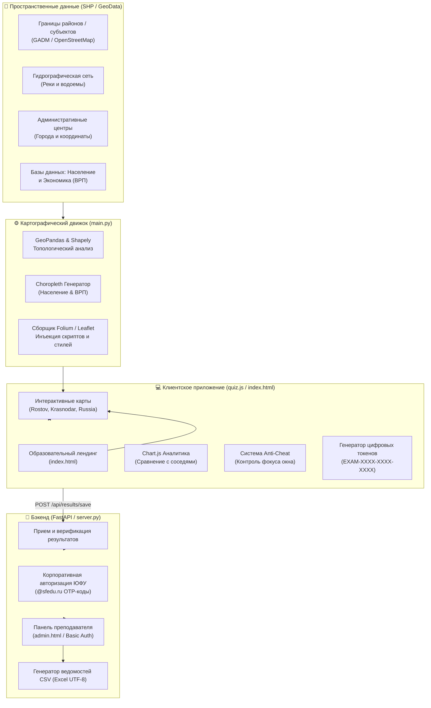

# 🌍 GeoAtlas Edu — Интерактивный геоинформационный и экономический комплекс

<p align="center">
  
  
  
  
  
  
</p>

---

> [!NOTE]
> **Академический контекст проекта**  
> Проект разработан в рамках выпускной квалификационной работы по направлению подготовки:  
> **44.03.05 «Педагогическое образование с двумя профилями подготовки: география и экономика»**.  
> **Автор:** Литвинов Е. К.  
> **Учебное заведение:** Институт наук о Земле Южного федерального университета (ЮФУ), г. Ростов-на-Дону.

---

## 📌 О проекте

**GeoAtlas Edu** — это учебно-методический аппаратно-программный комплекс, объединяющий возможности настольных географических информационных систем (ГИС), веб-картографии и современной образовательной платформы.

Комплекс решает фундаментальную задачу межпредметной интеграции **географии** и **экономики**: студенты и школьники изучают не просто административно-территориальное деление и гидрографию, но и пространственные социально-экономические закономерности (валовой региональный продукт — ВРП, численность и плотность населения, межтерриториальные связи и экономическое лидерство).

Платформа включает в себя:
* **Мультимасштабный геоатлас** (Ростовская область, Краснодарский край, Российская Федерация — 85+ субъектов);
* **Интерактивные аналитические профили территорий** со сравнительными диаграммами Chart.js;
* **Обучающий режим (Study Mode)** для самостоятельного исследования объектов;
* **4 геймифицированных режима викторин** с координатной валидацией ответов;
* **Интерактивный пазл «Собери регион»** — пространственная игра по сборке мозаики районов с визуальной анимацией и токеном аттестации;
* **Режим контрольной работы (Экзамен)** с системой защиты от списывания (Anti-Cheat) и формированием цифрового хэш-токена ведомости;
* **Кабинет преподавателя (Teacher Portal)** с мониторингом академических групп ЮФУ и выгрузкой ведомостей в Excel/CSV.

---

## 🏗️ Архитектура системы



---

## ✨ Ключевой функционал

### 1. 🗺️ Интерактивный атлас и пространственная аналитика
* **Многослойная картография:** Свободное переключение между базовой подложкой CartoDB Positron, полигонами районов, руслами рек и точечными маркерами административных центров.
* **Экономический и демографический Choropleth:** Отображение градиентных тепловых карт расселения и распределения ВРП по субъектам и районам.
* **Информационные карточки территорий:** При клике на район открывается подробное досье с расчетом площади, плотности населения, ВРП и списка смежных районов (топологических соседей).
* **Сравнительные 4-колоночные графики (Chart.js):** Наглядное сопоставление показателей:
  1. Текущий выбранный район/регион;
  2. Среднее значение по карте;
  3. Крупнейший географический сосед;
  4. Абсолютный лидер по региону/стране.

### 2. 🎓 Исследовательский режим (Study Mode)
* Режим свободного изучения номенклатуры без ограничений по времени и штрафов.
* Фокусировка камеры на выбранном объекте с плавной анимацией (`flyTo`).
* Фильтрация объектов по категориям: районы, гидрография, центры.

### 3. 🎯 Геймифицированные викторины
* **«Угадай территорию по силуэту»:** Карта скрывает подложку и показывает только контур района; задача — определить территорию по её уникальной геометрической форме.
* **«Гидрографическая сеть»:** Интерактивное подсвечивание русла реки; выбор верного гидронима из предложенных вариантов.
* **«Топология и смежность»:** Проверка понимания пространственных связей: выбор верного соседа либо исключение несмежной территории.
* **«Координатный поиск центров»:** Студент ставит маркер на карте по памяти; алгоритм вычисляет геодезическое расстояние (погрешность в км) между кликом и эталоном с градацией баллов от 3 до 0.

### 4. 🧩 Интерактивный пазл «Собери регион»
* **Контурная мозаика:** При запуске карта очищается до пустого внешнего контура региона, открывая интерактивную картографическую основу для сборки.
* **Трей районов:** В боковой панели отображаются карточки всех муниципальных образований в случайном порядке с подсказками по административным центрам и площадям.
* **Механика позиционирования:** Студент выбирает район и кликает в соответствующее место на контуре.
* **Анимация «впаивания»:** При правильном клике район фиксируется в общей мозаике с гармоничной цветовой заливкой и центроидной подписью. При ошибке — штрафной балл, вибрация карточки и подсветка неверного места.
* **Завершение и аттестация:** Подсчет точности, времени и выдача уникального токена сдачи (`PUZZLE-XXXX-XXXX`) с автоматической отправкой результата в ведомость преподавателя.

### 5. 📝 Режим контрольной работы (Экзамен)
* **Индивидуальная настройка среза:** Выбор категории (Комплексный экзамен, Границы, Реки, Центры, Топология), числа вопросов (10–25) и лимита времени (5–20 минут).
* **Глобальный таймер:** Обратный отсчет на всю работу с точностью до секунд и автоматической отправкой результатов при наступлении дедлайна.
* **Блокировка вспомогательных средств:** Подсказки принудительно отключены.
* **Двухуровневая защита от списывания (Anti-Cheat):**
  * Мониторинг ухода с вкладки через события `visibilitychange` и `window.blur`.
  * **1-е нарушение:** Предупреждающее окно с фиксацией замечания.
  * **2-е нарушение:** Немедленная дисквалификация, аннулирование работы и внесение отметки «Подозрение на списывание» в ведомость преподавателя.
* **Цифровой верификационный токен:** Формирование уникального кода подтверждения (например, `EXAM-A3F1-92D0-B47C`), который студент предъявляет преподавателю.

### 6. 👨‍🏫 Кабинет преподавателя (Панель мониторинга)
* Защищенный вход по протоколу HTTP Basic Auth (`sfedu_admin` / `geodean2026`).
* **KPI-мониторинг:** Общее число попыток, количество контрольных срезов, средняя успеваемость потока, число нарушений фокуса.
* **Сводка по академическим группам:** Рейтинг успеваемости групп ЮФУ с динамическими шкалами прогресса.
* **Интерактивный журнал:**
  * Живой поиск по ФИО, группе, email и токену;
  * Фильтры-таблетки: *«Все»*, *«Контрольные»*, *«Викторины»*, *«С нарушениями»*;
  * Цветовые индикаторы статуса: `✓ Сдано`, `⏳ Время истекло`, `⚠️ Завершено досрочно`, `🚨 Подозрение на списывание`;
  * Однокликовое копирование цифрового токена.
* **Экспорт ведомостей:** Мгновенная выгрузка журналов в формат CSV с кодировкой UTF-8 BOM для корректного открытия в Microsoft Excel на русском языке.

---

## 🛠️ Технологический стек

| Область | Технологии и библиотеки |
|---|---|
| **Язык разработки** | Python 3.10+, JavaScript (ES6+) |
| **ГИС и геоанализ** | GeoPandas, Shapely, PyProj, PyOgrio |
| **Картография** | Folium, Leaflet.js, CartoDB Basemaps |
| **Веб-сервер и API** | FastAPI, Uvicorn, Starlette, Pydantic |
| **Фронтенд и визуализация** | HTML5, CSS3 (Modern Glassmorphism & SFEDU Theme), Chart.js |
| **Хранилище данных** | JSON DataStore (`quiz_results.json`), Shapefiles (ESRI SHP) |

---

## 📁 Структура репозитория

```text
GeoAtlas/
├── Py_Geo/
│   └── shape/                  # Пространственные векторные слои
│       ├── rostov/             # Шейп-файлы Ростовской области (районы, центры, реки)
│       ├── krasnodar/          # Шейп-файлы Краснодарского края
│       └── russia_unified/     # Общероссийские генерализованные слои (GADM & Natural Earth)
├── admin.html                  # Панель преподавателя (ведомость ЮФУ, фильтрация, токены)
├── index.html                  # Главный образовательный лендинг платформы
├── main.py                     # ГИС-компилятор и генератор интерактивных карт
├── quiz.js                     # Модульный клиентский движок (викторины, экзамен, Anti-Cheat, Chart.js)
├── server.py                   # FastAPI сервер, авторизация, API сохранения и экспорт ведомостей
├── quiz_results.json           # База данных сданных работ и контрольных срезов
├── requirements.txt            # Зависимости Python
└── README.md                   # Документация проекта
```

---

## 🚀 Установка и запуск

### 1. Предварительные требования
* Установленный **Python 3.10** или выше.
* Установленный Git.

### 2. Клонирование и создание виртуального окружения
```bash
git clone https://github.com/your-username/geoatlas-edu.git
cd geoatlas-edu

# Создание виртуального окружения
python -m venv venv

# Активация окружения:
# Для Windows:
venv\Scripts\activate
# Для Linux/macOS:
source venv/bin/activate
```

### 3. Установка зависимостей
```bash
pip install -r requirements.txt
```

### 4. Генерация картографических слоев
Запустите ГИС-движок для компиляции актуальных интерактивных карт из пространственных шейп-файлов:
```bash
python main.py
```
> В результате работы скрипта будут собраны карты:
> * `rostov_quiz_map.html` — Ростовская область (детальные районы, центры, реки);
> * `krasnodar_quiz_map.html` — Краснодарский край;
> * `russia_quiz_map.html` — Российская Федерация (85+ субъектов).

### 5. Запуск веб-сервера платформы
```bash
python server.py
```
После старта веб-сервер доступен по локальному адресу: **[http://localhost:8000](http://localhost:8000)**.

---

## 🔑 Учетные данные для тестирования

| Роль | Страница входа | Логин / Email | Пароль / Код |
|---|---|---|---|
| **Преподаватель / Администратор** | [http://localhost:8000/admin](http://localhost:8000/admin) | `sfedu_admin` | `geodean2026` |
| **Студент ЮФУ** | Модальное окно входа в хедере | `*@sfedu.ru` | Одноразовый 6-значный OTP-код (выводится в консоль сервера) |

---

## 📡 Справка по API платформы

| Метод | Эндпоинт | Доступ | Описание |
|---|---|---|---|
| `GET` | `/` | Публичный | Главная страница образовательного портала (`index.html`) |
| `GET` | `/{map_name}.html` | Публичный | Доступ к сгенерированным интерактивным картам |
| `POST` | `/api/auth/send-code` | Публичный | Отправка проверочного кода авторизации на почту `@sfedu.ru` |
| `POST` | `/api/auth/verify-code`| Публичный | Верификация студента по одноразовому коду |
| `POST` | `/api/results/save` | Студент | Сохранение результата теста / экзамена с токеном и нарушениями |
| `GET` | `/api/results/leaderboard` | Публичный | Получение топа студентов для таблицы лидеров |
| `GET` | `/admin` | Basic Auth | Личный кабинет преподавателя и мониторинг успеваемости |
| `GET` | `/admin/export-csv` | Basic Auth | Скачивание итоговой ведомости в формате CSV (Excel UTF-8) |

---

## 🎓 Методическая ценность для педагогического образования

1. **Межпредметные связи:** Интеграция курса физической географии России, социально-экономической географии и региональной экономики.
2. **Формирующее оценивание:** Мгновенная обратная связь обучающемуся (визуализация ошибок на карте, расчет километража погрешности).
3. **Академическая честность:** Автоматизированный контроль соблюдения регламента проверочных работ и криптографическая верификация результатов с помощью цифровых токенов.
4. **Готовность к масштабированию:** Архитектура проекта позволяет подключать новые субъекты РФ при наличии векторных контуров в формате SHP/GeoJSON.

---

## 📄 Лицензия

Проект распространяется в образовательных и исследовательских целях.  
© 2026 Литвинов Е. К. | Институт наук о Земле ЮФУ. Все права защищены.
